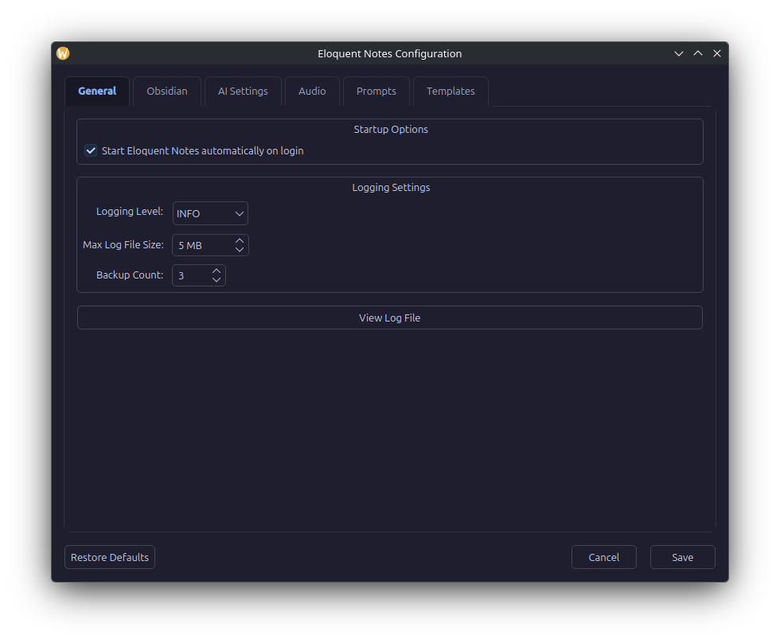

# Eloquent Notes for Linux

[](https://sonarcloud.io/summary/overall?id=arrase_eloquent-notes)
[](https://sonarcloud.io/summary/overall?id=arrase_eloquent-notes)
[](https://sonarcloud.io/summary/overall?id=arrase_eloquent-notes)
[](https://sonarcloud.io/summary/overall?id=arrase_eloquent-notes)
[](https://sonarcloud.io/summary/overall?id=arrase_eloquent-notes)
[](https://sonarcloud.io/summary/overall?id=arrase_eloquent-notes)
[](https://sonarcloud.io/summary/overall?id=arrase_eloquent-notes)
[](https://sonarcloud.io/summary/overall?id=arrase_eloquent-notes)
[](https://sonarcloud.io/summary/overall?id=arrase_eloquent-notes)
[](https://sonarcloud.io/summary/overall?id=arrase_eloquent-notes)
[](https://sonarcloud.io/summary/overall?id=arrase_eloquent-notes)

Eloquent Notes is a Linux system tray app, inspired by [Google Eloquent](https://developers.google.com/edge/eloquent), that turns voice dictations into well-structured, well-ordered notes. Press a shortcut, speak, press it again: a local **Gemma 4** model (via Ollama) transcribes the audio, rewrites it as clean prose with a title, classifies it and tags it. Each note is saved as a plain Markdown file, and a notes window lets you browse, search, edit and extend them.

Everything runs offline on your machine.

---

## ✨ Features

- **One-gesture capture:** left-click the tray icon, click the record button in the window, or bind `eloquent-notes toggle` to a global shortcut. A floating HUD shows the remaining time while you speak.
- **Clean notes, not transcripts:** a three-phase pipeline (transcription → rewriting → classification) removes filler words, writes a concise title and assigns a type (`note`, `task`, `idea`, `reminder`, `question`, `decision`) and 2–5 tags.
- **Plain Markdown files:** one file per note with YAML frontmatter, in a folder you choose. No database, no lock-in.
- **Notes window:** a timeline grouped by day, type and tag filters, and a reader where title, type, tags and body are editable.
- **Add dictation:** dictate more text into an existing note; it is rewritten and appended as a new paragraph.
- **Semantic search:** search notes by meaning with a local embedding model (`embeddinggemma-2:latest`). Embeddings are computed on demand and cached.
- **Multilingual:** dictate in any language and pick the output language for titles, prose and tags.
- **Customizable prompts:** every pipeline phase is driven by editable Markdown prompts.

---

## 📋 Prerequisites

1. **Ollama with a Gemma 4 model and an embedding model:**
   ```bash
   ollama pull gemma4:e4b-it-qat
   ollama pull embeddinggemma-2:latest
   ```
   > [!NOTE]
   > Gemma 4 audio models accept clips of up to **30 seconds**, so recordings stop automatically after `audio.capture_duration` (default 30 s).

2. **PortAudio** (audio capture and beeps) and a desktop notification server:
   ```bash
   # Ubuntu / Debian / Pop!_OS
   sudo apt install libportaudio2
   ```

3. **Python 3.11+**.

---

## 🚀 Installation

### Option A: `uv` or `pipx` (recommended)
```bash
uv tool install git+https://github.com/arrase/eloquent-notes.git
# or
pipx install git+https://github.com/arrase/eloquent-notes.git
```

### Option B: Local development install
```bash
git clone https://github.com/arrase/eloquent-notes.git
cd eloquent-notes
python3 -m venv .venv
source .venv/bin/activate
pip install -e ".[dev]"
```

---

## 🎮 Usage

### Start the app
```bash
eloquent-notes &                    # start the tray daemon (or open the notes window if it is already running)
eloquent-notes install-autostart    # start it automatically on login
```

### Record a note
1. Start recording: left-click the tray icon, click the record button in the notes window, or run `eloquent-notes toggle`. A beep plays and the icon turns **red**.
2. Speak (up to 30 s). The model is preloaded in the background while you talk.
3. Stop recording the same way. The icon turns **orange** while the note is written.
4. A **Note Saved** notification appears and the icon returns to **gray**. Click the notification to open the notes window. Silent recordings produce a **Dictation Empty** notification and no note.

### Tray icon

| Action | Effect |
| :--- | :--- |
| Left click | Start / stop recording |
| Middle click | Show / hide the notes window |
| Right click | Menu: **Start/Stop Recording**, **Open Notes**, **Configuration**, **Reload Configuration**, **Quit** |

### Notes window
Open it with a middle click on the tray icon, **Open Notes** in the menu, or `eloquent-notes open`.

- **Timeline:** notes grouped by day (Today, Yesterday, "Monday, 19 October", …), newest first.
- **Filters:** type chips (All, Notes, Tasks, Ideas, …) and a tag selector. Clicking a `#tag` on a card selects it.
- **Search:** type a query and press <kbd>Enter</kbd> to search by meaning. Clearing the box returns to the timeline.
- **Reader:** click a card to open it. Title, type, tags (comma separated) and body are editable and saved when you leave the reader or close the window. <kbd>Esc</kbd> goes back.
  - **Add dictation** records a new dictation and appends its rewritten text to the note, keeping its type and tags.
  - **Copy** copies the note as Markdown (`# Title` + body) to the clipboard.
  - **Delete** asks for confirmation and moves the file to the system trash.

### Global keyboard shortcut
Bind `eloquent-notes toggle` in your desktop environment:

- **GNOME:** Settings → Keyboard → View and Customise Shortcuts → Custom Shortcuts → **+**. Command: `eloquent-notes toggle`.
- **KDE Plasma:** System Settings → Shortcuts → Add New → Global Shortcut → Command/URL. Command: `eloquent-notes toggle`.
- **i3 / Sway:** `bindsym $mod+Ctrl+n exec --no-startup-id eloquent-notes toggle`

---

## 📝 Note Format

Each note is a Markdown file in the notes folder (default `~/Documents/Eloquent Notes`), named `YYYY-MM-DD HHMMSS Title.md`:

```markdown
---
title: Redis cache for Postgres
created: '2026-10-19T09:42:17+02:00'
type: idea
tags:
- redis
- caching
- performance
---
Consider using Redis as a caching layer to avoid hitting Postgres directly on slow queries.
```

- The timestamp prefix keeps file names unique and chronological; editing a title never renames the file.
- Files without valid frontmatter (`title`, `created`, a known `type`) are ignored, so the folder can live inside an Obsidian vault or any other Markdown collection.
- Files edited outside the app are picked up the next time the window refreshes; their embeddings are recomputed on the next search.

---

## ⚙️ Configuration

On first run, Eloquent Notes creates `~/.config/eloquent-notes/` with `config.yaml` and the prompt files.

### Configuration GUI
Open it from the tray menu (**Configuration**), the **Settings** button in the notes window, or `eloquent-notes config`. Saving reloads the running daemon.



- **General:** autostart on login, logging level, log rotation, view the log file.
- **Notes:** the notes folder.
- **AI Settings:** Ollama URL, audio model, output language, context length, keep-alive, retries and timeouts; **Semantic Search** group with the embedding model and minimum similarity. **Refresh** lists the audio-capable and embedding models installed in Ollama.
- **Audio:** sample rate, channels, maximum capture duration, recording HUD, beeps.
- **Prompts:** edit the transcription, rewriting, classification and retry prompts.

### `config.yaml`

```yaml
notes:
  folder: "~/Documents/Eloquent Notes"   # One Markdown file per voice note.

ai:
  ollama_url: "http://localhost:11434"
  model: "gemma4:e4b-it-qat"
  output_language: "English" # Output language for rewritten notes, titles, and tags.
  context_length: 8192 # If null or not set, the maximum allowed by the model is used.
  keep_alive: "0"       # Time to keep model loaded after note generation (e.g. "5m", "10m", or "0" to unload immediately).
  preload_keep_alive: "5m" # Time to keep model weights loaded in VRAM during recording to reduce note generation time.
  max_retries: 3        # Number of times to retry LLM execution if the output is not valid JSON.
  preload_timeout: 180  # Timeout in seconds for preloading the model weights.
  request_timeout: 300  # Timeout in seconds for note generation requests.

search:
  embedding_model: "embeddinggemma-2:latest"
  keep_alive: "5m"      # Time to keep the embedding model loaded between searches.
  min_similarity: 0.6   # Hide search results below this cosine similarity.

audio:
  sample_rate: 16000
  channels: 1
  capture_duration: 30
  recording_hud_enabled: true
  beep_frequency: 440
  beep_duration: 0.1
  beep_enabled: true

logging:
  level: "INFO"
  max_mb: 5
  backup_count: 3
```

### Prompts
Prompts live in `~/.config/eloquent-notes/prompts/`:

- `transcription_system.md`, `transcription_user.md` — Phase 1: audio to clean text.
- `rewriting_system.md`, `rewriting_user.md` — Phase 2: title and note prose.
- `classification_system.md`, `classification_user.md` — Phase 3: type and tags.
- `retry_prompt.md` — correction sent when a response is not valid JSON.

---

## 💻 CLI

| Command | Effect |
| :--- | :--- |
| `eloquent-notes` | Start the tray daemon; if it is already running, open the notes window. |
| `eloquent-notes toggle` (`-t`, `--toggle`) | Start / stop recording (starts the daemon if needed). |
| `eloquent-notes open` | Open the notes window (starts the daemon if needed). |
| `eloquent-notes config` | Open the configuration dialog. |
| `eloquent-notes install-autostart` | Install `~/.config/autostart/eloquent-notes.desktop`. |
| `eloquent-notes --version` | Print the installed version. |

Logs are written to `$XDG_STATE_HOME/eloquent-notes/app.log` (default `~/.local/state/eloquent-notes/app.log`) with rotation. The embedding cache lives at `$XDG_CACHE_HOME/eloquent-notes/embeddings.npz`.

---

## 📚 Documentation

Full documentation, including architecture and pipeline details: <https://arrase.github.io/eloquent-notes/>
