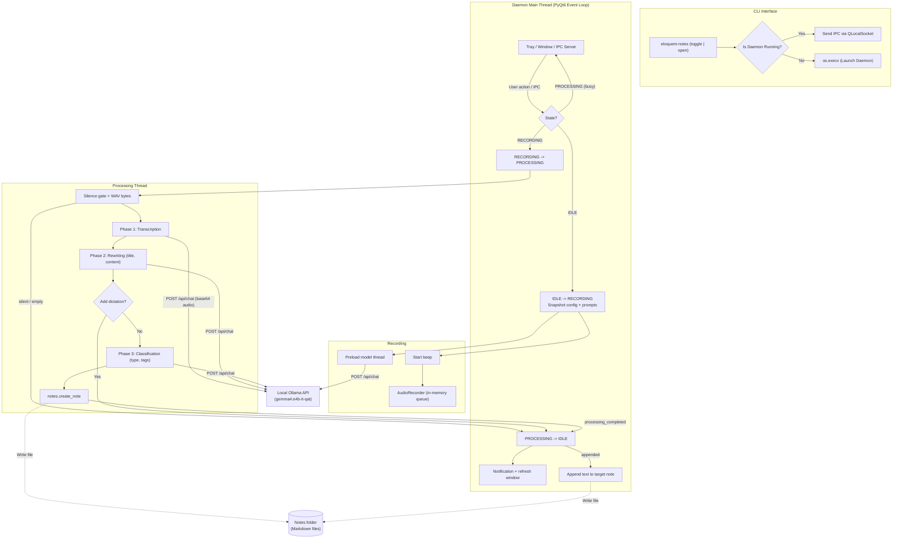

# System Architecture & Design

Eloquent Notes is a Linux tray daemon with one job: turn voice dictations into well-structured, well-ordered notes. It captures audio in memory, runs a local Ollama pipeline, writes one Markdown file per note, and offers a window to browse, edit and search those files. It emphasizes low resource use, data privacy and a responsive desktop.

---

## Module Overview

| Module | Responsibility |
| :--- | :--- |
| `main.py` | CLI entry point: `install-autostart`, `toggle`, `open`, `config`; single-instance IPC client; launches the daemon. |
| `app.py` | `EloquentApp` controller: tray icon and menu, IPC server, recording lifecycle, processing pipeline, notes window wiring, config reload. |
| `audio.py` | In-memory recording (`AudioRecorder`), silence detection and trimming, WAV encoding, beeps. |
| `llm.py` | Ollama client: model preload, the three pipeline phases with JSON-schema output and retries, `/api/embed`. |
| `notes.py` | Note storage: `Note` dataclass, load / create / save / append, frontmatter parsing, tag normalization. |
| `search.py` | `SemanticIndex`: embedding cache and cosine-similarity ranking. |
| `window.py` | `MainWindow`: timeline and reader pages. A pure view that reports user intent through signals. |
| `recording_hud.py` | Floating countdown overlay shown while recording (click to stop). |
| `ui.py` | Tray / record-button state icons drawn with `QPainter`. |
| `config.py` | XDG paths, default file installation, config loading/merging, atomic writes. |
| `config_gui/` | Configuration dialog (General, Notes, AI Settings, Audio, Prompts tabs). |
| `autostart.py`, `logging_utils.py` | Autostart desktop entry; rotating XDG log files. |

### Boundaries

- `window.py` never touches files, audio or models. It renders the `Note` objects it is given and emits signals (`record_clicked`, `dictate_clicked`, `note_edited`, `delete_requested`, `search_requested`, `settings_clicked`).
- `notes.py` and `search.py` have no Qt dependency; `llm.py` and `audio.py` neither.
- `EloquentApp` is the only place where these pieces meet and where application state changes.

---

## High-Level Component Architecture

```
┌─────────────────────────────────────────────────────────────────┐
│                      CLI / Hotkey Trigger                       │
│          `eloquent-notes [toggle | open | config]`              │
└────────────────────────────────────────┬────────────────────────┘
                                         │ QLocalSocket (IPC)
                                         ▼
┌─────────────────────────────────────────────────────────────────┐
│              Daemon Process (PyQt6 Event Loop)                  │
│                                                                 │
│  ┌─────────────────┐  ┌─────────────────┐  ┌─────────────────┐  │
│  │ QSystemTrayIcon │  │  QLocalServer   │  │   MainWindow    │  │
│  │  (state, menu)  │  │ (IPC listener)  │  │ timeline/reader │  │
│  └────────┬────────┘  └────────┬────────┘  └────────┬────────┘  │
│           └────────────────────┼────────────────────┘           │
│                                ▼                                │
│                     EloquentApp Controller                      │
│            (State: IDLE → RECORDING → PROCESSING)               │
└───────┬──────────────────────┬──────────────────────┬───────────┘
        ▼ (thread)             ▼ (thread)             ▼ (thread)
┌────────────────────┐ ┌────────────────────┐ ┌────────────────────┐
│ Model preload      │ │ Three-phase        │ │ Semantic search    │
│ (keep-alive chat)  │ │ pipeline (Ollama)  │ │ (/api/embed, cache)│
└────────────────────┘ └─────────┬──────────┘ └────────────────────┘
                                 ▼ (main thread)
                      notes.create_note / append_to_note
                      → Markdown files in notes.folder
```

---

## 1. System Tray & Inter-Process Communication (IPC)

### PyQt6 Daemon & Event Loop
The daemon runs on a `QApplication` event loop with `setQuitOnLastWindowClosed(False)`, so closing the notes window keeps it alive in the tray.

- **Left click** toggles recording, **middle click** shows/hides the notes window.
- The **context menu** offers Start/Stop Recording, Open Notes, Configuration, Reload Configuration and Quit.
- Clicking a **notification** opens the notes window.

### Single-Instance IPC
The CLI entry point (`eloquent_notes.main`) works as a lightweight client:

1. It creates a headless `QCoreApplication` (no display connection, no windows).
2. It connects to the named local socket `eloquent_notes_ipc` with `QLocalSocket`.
3. **If the daemon is running**, it writes `toggle` (for `toggle`/`-t`) or `open` (no command, or `open`) and exits. The daemon's `QLocalServer` dispatches `toggle` → `toggle_action()`, `open` → `show_window()`, `reload` → `reload_config()`.
4. **If no daemon is running**, it replaces its process with `python -m eloquent_notes.app [toggle|open]` via `os.execv`, so the new daemon starts recording or opens the window immediately.

`eloquent-notes config` opens the dialog in its own process and sends `reload` after a successful save.

---

## 2. Recording Lifecycle

`EloquentApp` owns a three-state machine:

| State | Entered by | Tray icon |
| :--- | :--- | :--- |
| `IDLE` | Startup, processing finished | Gray microphone |
| `RECORDING` | `toggle_action()` or `dictate_into(note)` while idle | Red dot |
| `PROCESSING` | Stop request or `capture_duration` reached | Orange hourglass |

At recording start, the configuration and all prompt files are copied into a **snapshot**, so editing settings mid-dictation cannot affect the note being processed. `dictate_into(note)` records the same way but remembers the target note; the pipeline then stops after Phase 2 and the text is appended to that note (see [Three-Phase AI Pipeline](pipeline.md)).

While processing, further toggles only show a "System is busy" notification; the record buttons in the window are disabled.

---

## 3. In-Memory Audio Capture & Zero Disk-IO

- **Stream capture:** `sounddevice.InputStream` enqueues float32 NumPy blocks into a `queue.Queue`.
- **Local silence gate:** `AudioRecorder.is_silent` compares the RMS level against a -45 dBFS speech threshold. Silent recordings never reach the model, which would otherwise invent text.
- **Silence trimming & WAV encoding:** `AudioRecorder.wav_bytes` trims leading/trailing silent blocks, converts to 16-bit PCM and writes a WAV file into an `io.BytesIO` buffer.
- **Base64 transmission:** the WAV bytes are base64-encoded and sent in the JSON body of `/api/chat`. No audio file is ever written to disk.

### Audible Feedback Cues
Start/stop beeps are sine waves synthesized with NumPy with a 10 ms linear fade-in/out to avoid clicks. The start beep plays synchronously before the microphone opens so it cannot leak into the recording.

---

## 4. Notes Storage & Window

Notes are plain Markdown files with YAML frontmatter in `notes.folder`; `notes.py` reads and writes them (see [Notes & Search](notes.md) for the format). There is no database and no in-memory index beyond the list of notes the window is currently showing.

The controller reloads the folder (`notes.load_notes`) whenever the window is shown, a note is created, edited, appended to or deleted, or the configuration is reloaded, and passes the list to `MainWindow.set_notes()`. Edits made in the reader are committed into the `Note` object and emitted as `note_edited`; the controller saves the file. Deletion uses `QFile.moveToTrash`.

The window uses the desktop palette with a small palette-based stylesheet, so it follows the system light/dark theme.

---

## 5. Dynamic In-Memory Icon Generation

State icons are drawn with `QPainter` into a `QPixmap` and wrapped in a cached `QIcon` (`ui.get_qicon(color)`). The same icons are used by the tray and by the record buttons in the window.

| State | Circle Color | Glyph |
| :--- | :--- | :--- |
| **IDLE** | Slate Gray (`#4B5563`) | White microphone |
| **RECORDING** | Vivid Red (`#DC2626`) | White recording dot |
| **PROCESSING** | Amber Orange (`#D97706`) | White hourglass |

---

## 6. Threading Model

All application and UI state changes happen on the Qt main thread. Only three kinds of work run on background `threading.Thread`s, and they report back exclusively through Qt signals:

1. **Model preloading** — started when recording begins; warms the Gemma 4 weights while the user speaks (best effort, errors are only logged).
2. **Audio processing** — `_process_audio()` runs the pipeline on the frozen snapshot and emits `processing_completed(status, detail)` with `success`, `appended`, `empty` or `error`. Note files for new notes are written on this thread by `notes.create_note`; appended text is written on the main thread when the signal arrives.
3. **Semantic search** — `_run_search()` calls `SemanticIndex.search()` (which serializes access to its cache with a lock) and emits `search_completed(query, results)` or `search_failed(query, message)`. The window ignores results for a query that is no longer current.

---

## Execution Flow


